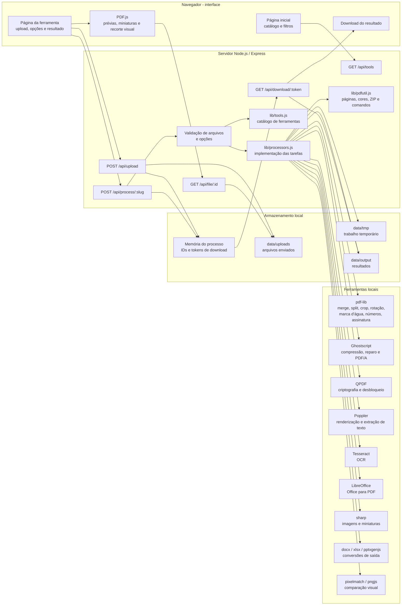
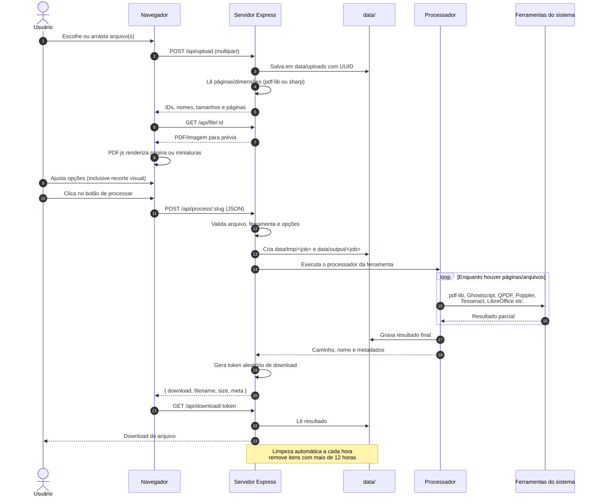
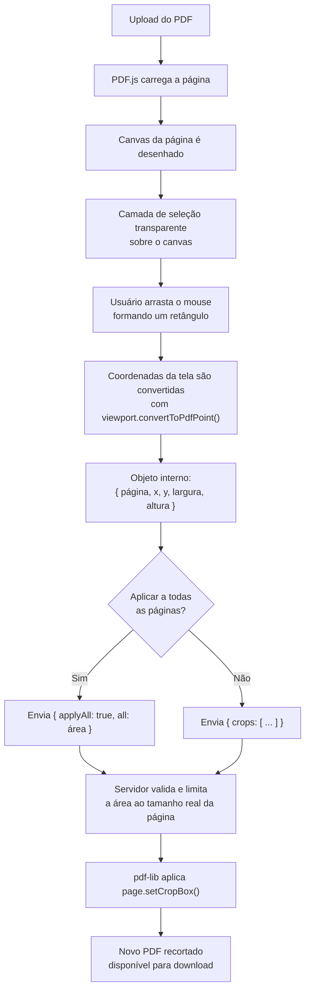
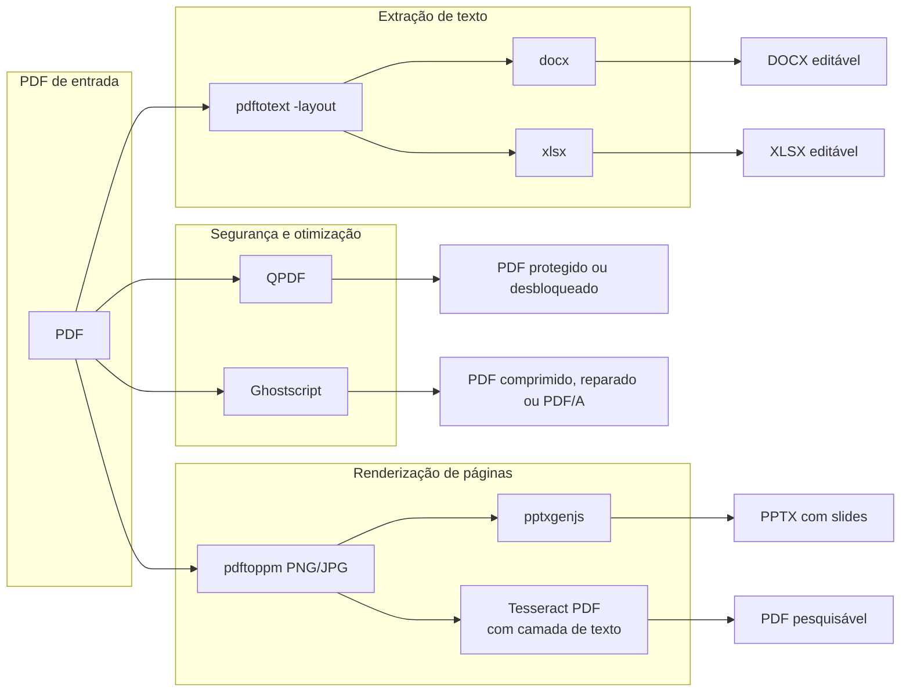
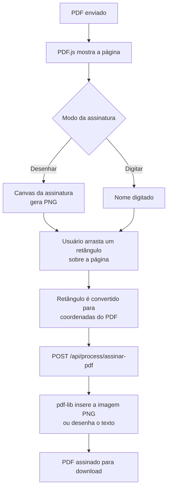
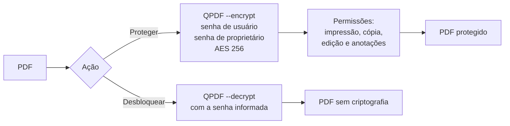
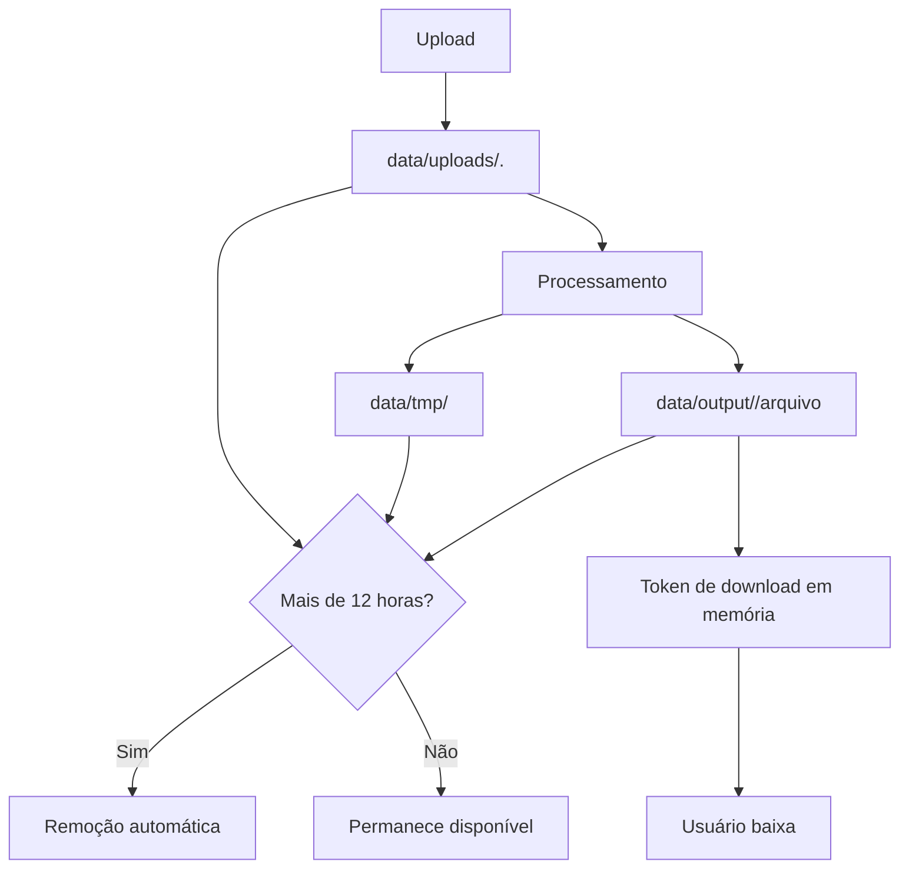
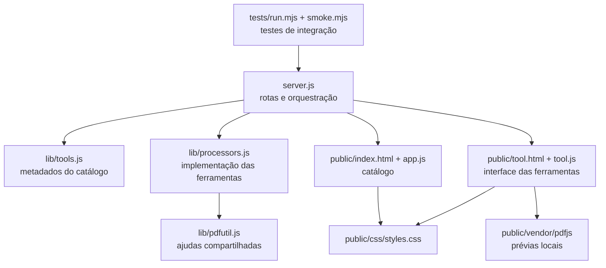

# Como funciona o PDF-Editor

Aplicação web local para manipular PDFs. O navegador cuida da interface e das prévias; o servidor Node.js executa as operações e usa ferramentas instaladas no próprio computador. Nenhum arquivo é enviado para a internet.

- Endereço padrão: `http://127.0.0.1:3000`
- Entrada: `npm start`
- Comandos e solução de problemas: [COMANDOS.txt](./COMANDOS.txt)

---

## 1. Visão geral da arquitetura

---

## 2. Fluxo completo de uma tarefa

---

## 3. Mapa de ferramentas e motores

| Ferramenta | Rota | Motor principal |
|---|---|---|
| Juntar PDF | `/ferramenta/juntar_pdf` | `pdf-lib` (`copyPages`) |
| Dividir PDF | `/ferramenta/dividir_pdf` | `pdf-lib` + ZIP (`archiver`) |
| Organizar PDF | `/ferramenta/organizar-pdf` | `pdf-lib` + miniaturas PDF.js |
| Remover páginas | `/ferramenta/excluir-paginas-do-pdf` | `pdf-lib` |
| Girar PDF | `/ferramenta/rodar_pdf` | `pdf-lib` (`setRotation`) |
| Recortar PDF | `/ferramenta/recortar-pdf` | PDF.js + `pdf-lib` (`setCropBox`) |
| Numerar páginas | `/ferramenta/pdf_inserir_numeros_de_paginas` | `pdf-lib` (`drawText`) |
| Marca d'água | `/ferramenta/pdf_inserir_marca_daigua` | `pdf-lib` (`drawText`) |
| Comprimir PDF | `/ferramenta/comprimir_pdf` | Ghostscript (`pdfwrite`) |
| Reparar PDF | `/ferramenta/reparar-pdf` | Ghostscript, fallback QPDF |
| PDF para PDF/A | `/ferramenta/pdf_para_pdfa` | Ghostscript (`-dPDFA=2`) |
| PDF para JPG | `/ferramenta/pdf_para_jpg` | Poppler (`pdftoppm`) + ZIP |
| JPG para PDF | `/ferramenta/jpg_para_pdf` | `sharp` + `pdf-lib` |
| PDF para Word | `/ferramenta/pdf_para_word` | Poppler (`pdftotext`) + `docx` |
| PDF para Excel | `/ferramenta/pdf_para_excel` | Poppler (`pdftotext`) + `xlsx` |
| PDF para PowerPoint | `/ferramenta/pdf_para_powerpoint` | Poppler + `pptxgenjs` |
| Word para PDF | `/ferramenta/word_para_pdf` | LibreOffice |
| Excel para PDF | `/ferramenta/excel_para_pdf` | LibreOffice |
| PowerPoint para PDF | `/ferramenta/powerpoint_para_pdf` | LibreOffice |
| OCR PDF | `/ferramenta/ocr-pdf` | Poppler + Tesseract + `pdf-lib` |
| Proteger PDF | `/ferramenta/proteger-pdf` | QPDF (`--encrypt 256`) |
| Desbloquear PDF | `/ferramenta/desbloquear_pdf` | QPDF (`--decrypt`) |
| Assinar PDF | `/ferramenta/assinar-pdf` | PDF.js + `pdf-lib` |
| Comparar PDFs | `/ferramenta/comparar-pdf` | Poppler + `pixelmatch` + ZIP |

---

## 4. Recorte visual (sem coordenadas)

O recorte foi feito para ser 100% visual. O usuário não digita `x`, `y`, largura ou altura.

Detalhes:

- A prévia usa PDF.js em `public/js/tool.js`.
- O retângulo é desenhado por cima do canvas, sem inputs de coordenadas.
- A conversão para o espaço do PDF considera rotação e escala da página.
- O servidor ainda valida e limita a área para impedir valores inválidos.
- O mesmo raciocínio visual é usado em **Assinar PDF**.

---

## 5. Como cada grupo de conversão funciona

Conversões de Office para PDF seguem o caminho inverso: o LibreOffice abre o documento local e exporta diretamente para PDF com `soffice --headless --convert-to pdf`.

---

## 6. Assinatura visual

> A assinatura é visual. Não é uma assinatura digital certificada com ICP-Brasil ou certificado X.509.

---

## 7. Proteção e desbloqueio

O PDF protegido exige a senha para abrir. A senha não é armazenada em lugar nenhum.

---

## 8. Dados, privacidade e limpeza

- O servidor escuta em `127.0.0.1` por padrão.
- Não há chamadas para serviços externos.
- PDF.js, fontes e mapas de caracteres ficam em `public/vendor/pdfjs`.
- Arquivos são identificados por UUID; não há listagem pública de uploads.
- Downloads usam tokens aleatórios.
- A limpeza roda a cada hora e remove o que passou de 12 horas.

---

## 9. Estrutura do código

---

## 10. Como adicionar uma nova ferramenta

1. Adicione o item em `lib/tools.js` com `slug`, título, descrição, categoria, `endpoint` e tipos aceitos.
2. Crie o processador em `lib/processors.js` e registre no objeto `PROCESSORS`.
3. Se precisar de opções próprias, adicione um construtor em `OPTION_BUILDERS`, no `public/js/tool.js`.
4. Defina `getOptions()` para devolver as opções e `validateOptions()` para validar no navegador.
5. Adicione um caso de teste em `tests/smoke.mjs`.
6. Rode `npm test` e valide a página em `http://127.0.0.1:3000/ferramenta/<slug>`.

---

## 11. Limitações conhecidas

- **Resumir PDF** e **Traduzir PDF** não foram incluídos: dependeriam de um modelo de IA externo ou local adicional.
- **Editar PDF** como editor gráfico livre (texto, formas, imagens e anotações em lote) não está incluído.
- A assinatura é visual, não certificada digitalmente.
- PDF para Word e Excel são baseados no texto extraído; layouts muito complexos podem exigir ajustes.
- OCR depende dos idiomas instalados no Tesseract.
- A comparação é visual (pixel a pixel), não semântica.
